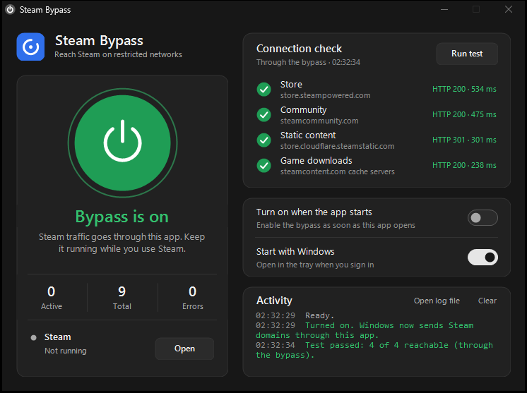
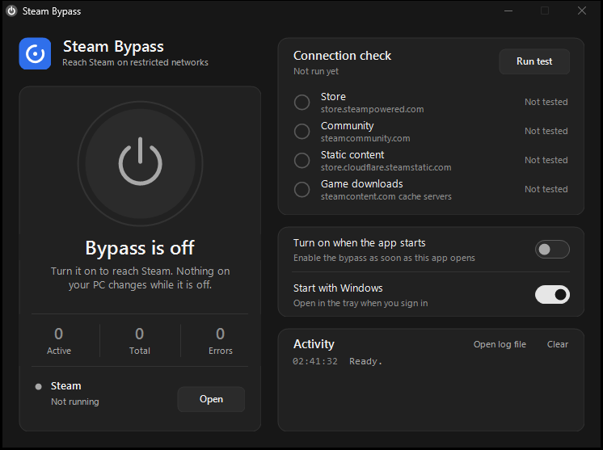

# Steam Bypass

A small Windows tray app that restores access to Steam (store, community, login **and game downloads**) on networks that block it with **DNS poisoning** and **DPI filtering of the TLS SNI / HTTP `Host` header**.

- No VPN, no driver, no administrator rights, no DNS changes on your machine.
- One `.exe` built from a single C# file with the compiler that ships with Windows.
- Only Steam traffic goes through it; everything else stays direct.
- Turn it on and off from the tray. Turning it off restores your Windows settings.

> Written and tested against the Steam restrictions seen in Vietnam in October 2026. Other networks may block differently, so see [How it was investigated](#how-it-was-investigated) to check what yours does.

<p align="center">
  
  
</p>
<p align="center">
  
</p>

## Contents

- [How Steam is being blocked](#how-steam-is-being-blocked)
- [How the bypass works](#how-the-bypass-works)
- [Install](#install)
- [Usage](#usage)
- [How it was investigated](#how-it-was-investigated)
- [What did not work](#what-did-not-work)
- [Limitations](#limitations)
- [Troubleshooting](#troubleshooting)
- [Project layout](#project-layout)
- [Disclaimer](#disclaimer)

## How Steam is being blocked

The block is layered. Defeating only one layer leaves Steam half-working, which is exactly the symptom people report (the store opens as unstyled HTML, or login works but downloads sit at `0 B/s`).

| # | Layer | What the ISP does | Symptom |
|---|-------|-------------------|---------|
| 1 | **DNS poisoning** | The ISP resolver answers `127.0.0.1` for Steam domains (`steampowered.com`, `steamcontent.com`, `steamserver.net`, ...). Plain UDP queries to well-known public resolvers such as `8.8.8.8` were intercepted too and answered with a non-Steam address (`118.68.82.144` in our tests). | Pages and downloads fail with "no connection"; changing DNS to Google often does nothing. |
| 2 | **TLS SNI filtering (DPI)** | A middlebox reads the server name in the first packet of an HTTPS connection (the SNI in the TLS ClientHello). If it names Steam, it sends a TCP **RST** and the connection dies. | `Connection reset`, even when you connect to the correct IP. |
| 3 | **HTTP `Host` filtering (DPI)** | Steam game data is downloaded over **plain HTTP on port 80** from `cacheN-xxx.steamcontent.com`. The middlebox matches the exact string `Host:` (or `host:`) followed by a Steam name and resets the connection. | Login works, the library loads, but downloads never start. |

An important detail about layer 1: **Steam's download engine ignores the Windows proxy settings and does its own DNS lookups.** When the ISP answers `127.0.0.1`, Steam simply connects to `127.0.0.1:80`, where nothing is listening, and reports *"No internet connection"* / *"Connection timed out"*.

## How the bypass works

Steam Bypass runs two local listeners and tells Windows to use one of them only for Steam hostnames.

```
                         ┌────────────────────────────── Steam Bypass ──────────────────────────────┐
 Browser / Steam client  │                                                                          │
 (HTTPS, via PAC) ───────┼──▶ 127.0.0.1:18081  HTTP proxy ── split 1st TLS packet ─────────┐        │
                         │                                                                 ▼        │
 Steam downloader        │                                                    real Steam / CDN servers
 (HTTP, poisoned DNS) ───┼──▶ 127.0.0.1:80     forwarder  ── rewrite "Host:" → "HoSt:" ────┘        │
                         │                                                                          │
                         │     DNS for Steam hosts: DNS-over-HTTPS (1.1.1.1 / 8.8.8.8 / ...)        │
                         └──────────────────────────────────────────────────────────────────────────┘
```

### 1. DNS: ask over HTTPS instead

The app never trusts the system resolver for Steam hostnames. It queries **DNS-over-HTTPS** (`https://1.1.1.1/dns-query`, then `https://8.8.8.8/resolve`, then `cloudflare-dns.com` and `dns.google` as fallbacks). DoH looks like ordinary HTTPS to the ISP, so it cannot be hijacked like UDP port 53. The IP-literal URLs are tried first so no DNS is needed to bootstrap. Answers are cached for their TTL (clamped to 30 to 300 s).

### 2. HTTPS: split the first TLS packet

The DPI box can only read the SNI when the whole ClientHello arrives in one TCP segment starting with a well-formed TLS record header. The proxy receives a `CONNECT host:443` request, opens the real connection and sends the first **2 bytes** of the ClientHello as their own TCP segment (`TCP_NODELAY`, then a 20 ms pause) before sending the rest. The Steam server reassembles the stream normally. The DPI box fails to parse it and lets the connection through.

### 3. HTTP: respell the `Host` header

The same middlebox matches the header name case-sensitively, so `HoSt:` passes while `Host:` and `host:` are reset. The app rewrites the header on every request and forwards it. Servers treat header names as case-insensitive, so nothing changes for them.

### 4. Catching Steam's own downloader

Because the ISP's poisoned answer is `127.0.0.1`, Steam's downloader connects to `127.0.0.1:80`. The app listens there, reads the `Host:` header to learn which cache server Steam wanted (`cache8-hkg1.steamcontent.com`, ...), resolves its real address over DoH, and forwards the request with the respelled header. Steam multiplexes many cache hosts over the same loopback connection, so the upstream connection is switched per request. In practice this sustains hundreds of Mbit/s.

### 5. Routing with a PAC file

Turning the bypass on writes a [proxy auto-config](https://developer.mozilla.org/docs/Web/HTTP/Proxy_servers_and_tunneling/Proxy_Auto-Configuration_PAC_file) URL (`http://127.0.0.1:18081/proxy.pac`) to `HKCU\...\Internet Settings\AutoConfigURL`. The PAC (generated from `steam-domains.txt`) returns `PROXY 127.0.0.1:18081; DIRECT` for Steam domains and `DIRECT` for everything else. The `; DIRECT` fallback means that if the app dies, traffic goes direct instead of breaking your browsing. The previous value of `AutoConfigURL` is saved and restored on exit, on "Turn OFF", and on the next start after a crash.

## Install

**Requirements:** 64-bit Windows. Developed and tested on Windows 11; Windows 10 should work but is untested. Nothing to download: the C# compiler (`csc.exe`, .NET Framework 4.x) is already part of Windows.

```bat
git clone https://github.com/minhdevtree/steam-bypass.git
cd steam-bypass
app\build.bat
```

(No `git`? Use **Code → Download ZIP** on GitHub and unzip it.)

`build.bat` produces `SteamBypass.exe` in the repository root. **Keep it next to `steam-domains.txt`**; the app reads the domain list from its own folder.

Ports `127.0.0.1:18081` and `127.0.0.1:80` must be free. Stop any local web server (IIS, Apache, nginx, ...) that uses port 80 while the bypass is on.

## Usage

1. Run `SteamBypass.exe`. A round **S** icon appears in the tray (grey = off, green = on).
2. Click **Turn ON**.
3. Reload the browser tab. If the Steam client was already open, the app offers to **restart Steam** (also available in the tray menu): `steam.exe` reads the Windows proxy settings only when it starts, so a Steam opened *before* the bypass was turned on shows `NO CONNECTION` and cannot sign in or use the store.
4. Click **Run test** at any time. The *Connection check* card requests the store, the community, a static-content host and the game-download path (a Steam cache server through the `127.0.0.1:80` forwarder) and shows a green tick with the HTTP status and latency for each, or a red cross with the reason.

| Control | Effect |
|---|---|
| Left-click tray icon | Open the window |
| Right-click tray icon | Open / Turn ON-OFF / Run test / Restart Steam / Exit |
| Close button (X) | Hide to tray; the bypass keeps running |
| Exit (tray menu) | Turn the bypass off, restore Windows proxy settings, quit |
| *Turn on when app starts* | Enables the bypass as soon as the app launches |
| *Start with Windows* | Adds a `HKCU\...\Run` entry that launches `SteamBypass.exe --tray` at logon |

When the window is not in front (you used the tray menu, or the app turned itself on at sign-in), a small **on-screen notice** appears at the bottom of the screen, for example "Bypass is on" or "Steam is already open". It is drawn by the app instead of the Windows tray balloon, so Focus Assist cannot swallow it; it never takes focus, ignores clicks, and stays longer for warnings and errors.

Game downloads only work **while the app is running with the bypass on**. Steam's downloader depends on it.

### Command-line flags

| Flag | Meaning |
|---|---|
| `--tray` | Start hidden in the tray |
| `--on` | Turn the bypass on at launch |
| `--off` | Restore the Windows proxy setting and exit (use it if the app was killed and Windows still points at the dead proxy) |

### Customising the domain list

Edit `steam-domains.txt` (one domain per line; a domain also covers its subdomains; `#` starts a comment), then turn the bypass off and on again. Hosts in this list are routed through the proxy and resolved over DoH.

## How it was investigated

Everything above was measured, not assumed. These are the checks to repeat if you want to know what your own network does.

**DNS poisoning**
```powershell
Resolve-DnsName store.steampowered.com -Type A                    # ISP resolver: 127.0.0.1
Resolve-DnsName store.steampowered.com -Type A -Server 1.1.1.1    # real addresses
Resolve-DnsName store.steampowered.com -Type A -Server 8.8.8.8    # intercepted: a non-Steam address
```

**IP is reachable, so it is not an IP block**
```powershell
Test-NetConnection 23.15.142.182 -Port 443                         # TcpTestSucceeded : True
```

**SNI filtering.** Same IP, different SNI:
```bat
curl --resolve example.com:443:23.15.142.182     https://example.com/            :: handshake succeeds
curl --resolve store.steampowered.com:443:23.15.142.182 https://store.steampowered.com/  :: connection reset
```

**Which packet tricks defeat the SNI filter.** A small test program captured a real TLS 1.2 ClientHello for `store.steampowered.com` and replayed it to the real IP in different shapes:

| Variation | Result |
|---|---|
| Unmodified | reset |
| Split at byte 1 or 2 | **works** |
| Four segments, cut at SNI offset -2, +3 and +9 | **works** |
| Split exactly at the SNI start, or 5 bytes into it | reset |
| Every 3 bytes through the SNI | reset |
| 500 ms gap between pieces | no difference |
| TLS record fragmentation (two TLS records) | **works** |
| UPPERCASE or mIxEd-case SNI | reset |
| SNI with a trailing dot (`steampowered.com.`) | **works** |

We did not work out the filter's exact parsing rules. The one pattern that was consistent and simple is that cutting inside the first two bytes (the TLS record header) always got through, so the app uses the **2-byte split**: the server just sees an ordinary TCP stream, so it needs no cooperation from Steam.

**HTTP `Host` filtering.** Plain HTTP to the real IP with different spellings of the header:

| Header | Result |
|---|---|
| `Host:` / `host:` | reset |
| `HoSt:`, `hOST:`, `HOST:`, `hoST:` | **works** |
| `Host:` without space, with tab, trailing dot, or split across two packets | reset |

Keep-alive matters: a second request on the same connection that uses the plain spelling is reset again, so **every** request's header is rewritten, not just the first.

**How Steam downloads.** Steam's `logs\content_log.txt` showed the failure directly:

```
HTTP (SteamCache,363) - cache8-hkg1.steamcontent.com (127.0.0.1:80 / 127.0.0.1:80, host: cache8-hkg1.steamcontent.com): failed to send manifest request
```

and `Get-NetTCPConnection` showed the client stuck in `SynSent` to `127.0.0.1:80`, while the browser engine (`steamwebhelper`) did use the system proxy.

## What did not work

- **Changing the DNS server alone** (`8.8.8.8`, `1.1.1.1`): fixes layer 1 for some hostnames but not the DPI layers, and `8.8.8.8` over UDP is intercepted anyway.
- **[GoodbyeDPI](https://github.com/ValdikSS/GoodbyeDPI) 0.2.2** (packet-level desync via the WinDivert driver): modes `-1` to `-6` ran but did not unblock Steam; modes `-7`, `-8` and `-9` exited immediately on Windows 11. It also needs administrator rights and a kernel driver, which a plain user-space proxy avoids.
- **System proxy / PAC alone**: fixes the browser and the Steam UI but not game downloads (see section 4).

## Limitations

- **Depends on the poisoned DNS answer.** The downloader path works because the ISP answers `127.0.0.1`. If your resolver returns the *real* Steam IP instead (for example you set `1.1.1.1` system-wide), Steam connects directly with a plain `Host:` header and gets reset. Use your ISP's DHCP-provided DNS.
- **Plain TCP only.** QUIC / HTTP/3 over UDP is not handled.
- **Apps that ignore the Windows proxy** and do not use `127.0.0.1:80` are not covered.
- Developed and verified on a single network. A different ISP or a stricter DPI (full TCP reassembly, IP-based blocks) may need different tricks.
- Anything the DPI vendor updates can break it. Check [Troubleshooting](#troubleshooting).

## Troubleshooting

| Problem | What to do |
|---|---|
| Windows still points at the proxy after a crash | Run `SteamBypass.exe --off` |
| *Run test* shows red crosses | Look at `steam-bypass.log` next to the `.exe`. Errors such as `DNS failed` mean DoH is unreachable; `cannot connect` means the upstream IP is blocked. |
| Log shows "cannot listen on 127.0.0.1:80" | Another program uses port 80. Stop it, or run `netstat -ano \| findstr :80`. |
| Steam shows `NO CONNECTION`, the store says "error communicating with the Steam servers", or *Add to Account* does nothing | Steam was started before the bypass was turned on. Use **tray menu → Restart Steam** (or exit Steam and start it again while the bypass is ON). |
| Steam downloads stay at `0 B/s` | Make sure the app is **ON**, then restart Steam or press the retry button on the stalled download. Check that `Resolve-DnsName cache8-hkg1.steamcontent.com` returns `127.0.0.1` (your DNS must be the ISP one). |
| A browser still cannot reach Steam | Reload after turning ON. Browsers cache PAC results briefly; if needed, restart it. |
| Windows Defender quarantines `SteamBypass.exe` (for example `Trojan:Win32/Bearfoos.A!ml`) | A generic machine-learning detection (the `!ml` suffix), not a known-malware signature. The `.exe` is unsigned, opens local sockets, edits the per-user proxy setting and can add a `Run` entry, which is the profile such heuristics dislike. Read the source (about 1,800 lines in `app/`) and build it yourself before trusting it. If you do, add an exclusion for the project folder in *Windows Security → Virus & threat protection → Manage settings → Exclusions*, and consider [reporting the false positive to Microsoft](https://www.microsoft.com/wdsi/filesubmission). Defender also removes the *Start with Windows* entry when it quarantines the file, so re-enable that switch afterwards. |

Runtime log: `steam-bypass.log`. Settings: `settings.ini` (just `AutoOn=0|1`). Windows registry touched: `HKCU\Software\Microsoft\Windows\CurrentVersion\Internet Settings\AutoConfigURL` and, if enabled, `HKCU\...\Run\SteamBypass`.

## Project layout

```
app/SteamBypass.cs   Entry point, settings, system-proxy (PAC) handling, domain list, DoH resolver, the proxy itself
app/MainForm.cs      Window, tray icon and menu, connection check, Steam restart
app/Controls.cs      Owner-drawn dark UI controls (power button, toggle switch, cards, check rows)
app/app.manifest     Runs as the invoking user (no elevation), DPI aware
app/build.bat        Builds ..\SteamBypass.exe with the built-in .NET Framework compiler
steam-domains.txt    Domains routed through the proxy
```

## Disclaimer

This tool is provided as-is for lawful personal use, to reach a service that is not prohibited by law but is currently unreachable because of how your network is configured. It does not hide your identity, change your IP address, or circumvent Steam's own regional pricing, licensing, or payment rules. You are responsible for complying with the laws that apply to you and with Steam's Subscriber Agreement. It is not affiliated with Valve Corporation.

## License

[MIT](LICENSE)
